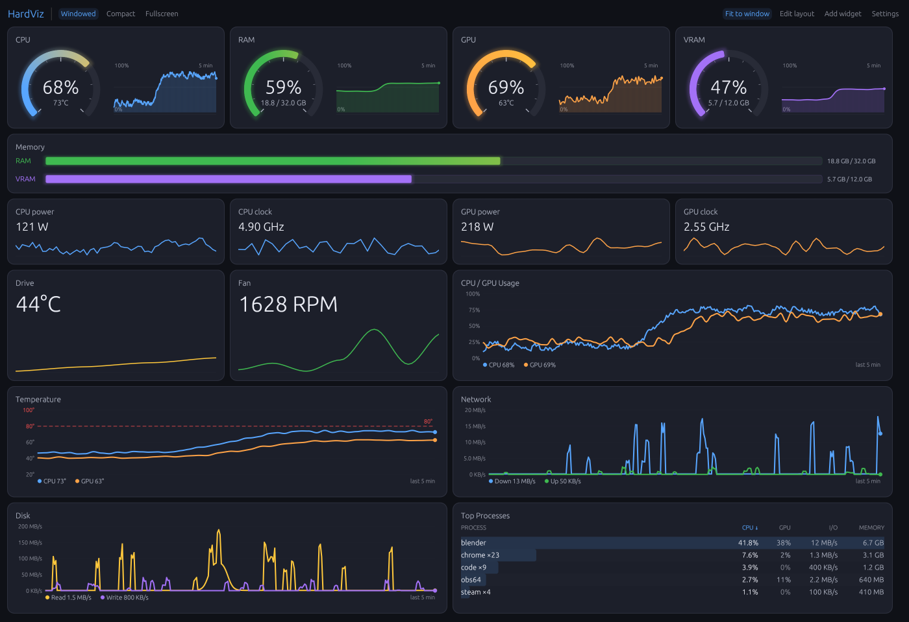
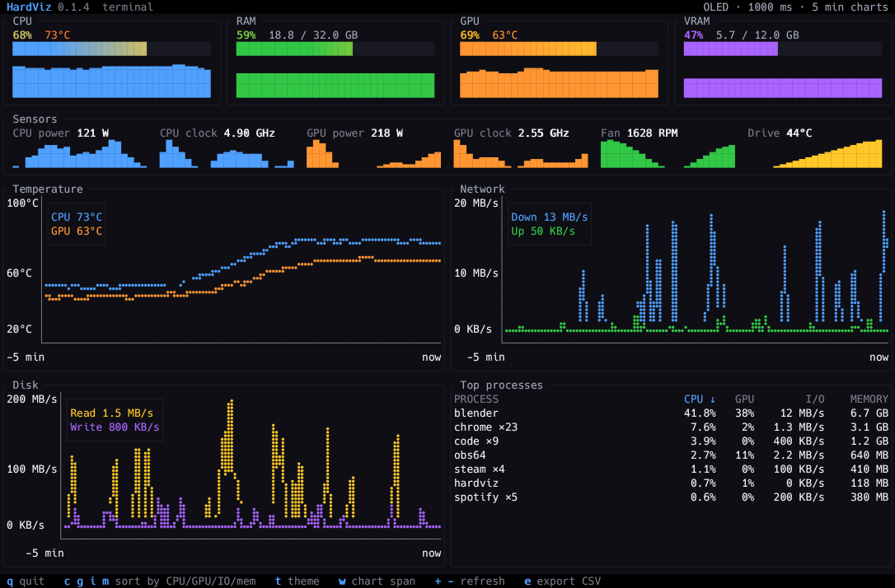

# HardViz

[](https://github.com/liorbass/hardviz/releases/latest)
[](https://github.com/liorbass/hardviz/actions/workflows/ci.yml)
[](https://github.com/liorbass/hardviz/releases)


[](https://github.com/liorbass/hardviz/releases/latest/download/hardviz-windows-x64.zip)
[](https://github.com/liorbass/hardviz/releases/latest/download/hardviz-linux-x64.tar.gz)
[](https://github.com/liorbass/hardviz/releases/latest/download/hardviz-macos-arm64.tar.gz)

HardViz keep an eye on your hardware,
Modular, FAST, LITE. For Windows, Linux and macOS, built with Rust and [egui](https://github.com/emilk/egui)..

This was built for my own usage, I didn't find any monitoring tool that I can setup the exact way I wanted, so we got this.




Prefer a terminal? `hardviz-tui` draws the same readings in any console —
over SSH, on a machine without a desktop, or in a spare pane:



Download, unzip, run. There is no installer, no service and no account, and
deleting one folder is the whole uninstall. The only thing HardViz sends over
the network is an optional update check to GitHub — a quiet link when a newer
release exists, nothing downloaded or installed, and one checkbox turns it
off ([details](docs/usage.md#updates)).

Two promises worth making up front:

- **It never guesses.** When a sensor cannot be read, the card says `N/A` and
  hovering it explains why. You will never get a misleading zero and have to
  wonder whether your GPU is actually fine.
- **It keeps watching.** Readings are sampled on their own thread, so history
  keeps filling even while the window is hidden or unfocused.

## What you get

- **Gauges** — CPU, RAM, GPU and VRAM: an arc for right now, a 300-sample
  sparkline for the last five minutes.
- **Charts** — CPU/GPU usage, temperatures with an 80 °C threshold line,
  network down/up and disk read/write on auto-scaled axes, RAM/VRAM capacity
  bars — all on a rolling five-minute window.
- **Sensor tiles** — CPU/GPU power and clock, the hottest drive, the fastest
  fan, each with a one-minute sparkline. Only sensors your machine actually
  reports are shown.
- **Top processes** — grouped by executable, sortable by CPU, GPU, I/O or
  memory: click a column header.
- **View modes** — windowed, OS-fullscreen, and a compact overlay: a
  borderless 640×96 strip that stays on top (📌 toggles that), drags anywhere,
  remembers where you left it, and fades to your chosen opacity.
- **Five themes** — Midnight, Light, OLED Black, Cyberpunk, Solarized.
- **A layout that is yours** — add any card as many times as you like, hide
  it, reorder by drag-and-drop (behind a lock toggle), resize by its corner.
- **A terminal UI** — `hardviz-tui`, with the same sources, the same
  fallbacks and your theme's colours: see
  [the terminal UI](docs/usage.md#terminal-ui).

## Get it running

Grab the archive for your platform from the buttons above (or the
[releases page](https://github.com/liorbass/hardviz/releases)), extract it
somewhere permanent, and run it:

| Package | Contents |
|---|---|
| `hardviz-windows-x64.zip` | `hardviz.exe`, `hardviz-tui.exe`, bundled LibreHardwareMonitor for CPU temperature |
| `hardviz-linux-x64.tar.gz` | `hardviz`, `hardviz-tui` |
| `hardviz-macos-arm64.tar.gz` | `HardViz.app`, `hardviz-tui`; Apple Silicon, macOS 11+ |

First-launch prompts (SmartScreen, Gatekeeper), starting at login and
removing it again — step by step for each OS — are in
[docs/install.md](docs/install.md).

From source, with a stable Rust toolchain:

```sh
cargo run --release                     # the window
cargo run --release --bin hardviz-tui   # the terminal UI
```

Requirements per OS, tests, CI and cutting a release:
[docs/building.md](docs/building.md).

## How it works

Everything flows through metric ids like `cpu.temp`. **Sources** produce
readings on a background thread — LibreHardwareMonitor on Windows, hwmon and
`/proc/diskstats` on Linux, SMC / IOReport / I/O Kit on macOS, NVML for NVIDIA
GPUs, `sysinfo` everywhere — and **widgets** ask for ids and draw whatever the
store holds. Neither side knows about the other: a new sensor automatically
feeds every widget that asks for it, and when several sources can provide the
same metric, the first enabled, healthy one wins. That is what gives CPU
temperature its automatic LHM → ACPI → hwmon fallback, and what makes adding
a sensor or a card a line or two, not a feature project.

The threading, the locks, the store's history semantics and the layout grid
are spelled out in [docs/architecture.md](docs/architecture.md).

## Documentation

| | |
|---|---|
| [Install](docs/install.md) | where to put it, first launch, start at login, uninstall |
| [Usage](docs/usage.md) | top bar, shortcuts, themes, settings, layout behaviour, the terminal UI, update checks |
| [Data sources](docs/data-sources.md) | every reading, where it comes from, and CPU temperature on each OS |
| [Configuration](docs/configuration.md) | the one JSON file: where it lives, hand-editing, factory reset |
| [Troubleshooting](docs/troubleshooting.md) | when something reads `N/A`, and what the log says |
| [Architecture](docs/architecture.md) | how it is put together — read this before changing threading or layout |
| [Building and releasing](docs/building.md) | requirements, tests, CI, packaging, version bumps |

## Extending HardViz

Most extensions are a line or two:

| I want to… | Change | Read |
|---|---|---|
| chart, gauge or sensor-tile existing metrics | one entry in `default_registry()` (`widgets/mod.rs`) | [docs/adding-widgets.md](docs/adding-widgets.md) |
| add a reading an existing source can get | one `metric::*` constant + one `out.set(...)` | [docs/adding-sensors.md](docs/adding-sensors.md) |
| add a new backend (data source) | a `MetricSource` impl + one line in `default_sources()` | [docs/adding-sensors.md](docs/adding-sensors.md) |
| add a new kind of visualisation | a `Widget` impl (just `draw`) + one registry line | [docs/adding-widgets.md](docs/adding-widgets.md) |
| add or tweak a theme | a preset in `theme.rs` | [docs/adding-themes.md](docs/adding-themes.md) |
| understand threading, locks, layout and fit | — | [docs/architecture.md](docs/architecture.md) (with diagrams) |

## When something reads N/A

That is the app telling the truth: the sensor is not there, or not readable
yet. Hover the card — or its row in **Settings → Metrics** — for the reason.
[docs/troubleshooting.md](docs/troubleshooting.md) covers the common cases on
every OS, including how to read the log
(`<config_dir>/hardviz.log`).

## Bundled third-party binary

`vendor/LibreHardwareMonitor/` holds a redistributed copy of
[LibreHardwareMonitor](https://github.com/LibreHardwareMonitor/LibreHardwareMonitor)
0.9.6, used on Windows to read CPU temperature over its HTTP JSON endpoint.
Only its customised `LibreHardwareMonitor.config` and `LICENSE` are in git. CI
downloads the official 0.9.6 `LibreHardwareMonitor.zip` (SHA-256
`086d9f1b…c001`, byte-identical to the copy this was developed with) into that
folder for release builds; for a local build with LHM, do the same, keeping
the tracked config.

- License: **Mozilla Public License 2.0**. The full license text is included
  at `vendor/LibreHardwareMonitor/LICENSE` and is copied next to the
  executable by `build.rs`, so it ships with the release folder as MPL-2.0
  requires.
- Copyright the LibreHardwareMonitor contributors. HardViz is not affiliated
  with, nor endorsed by, that project.
- The bundled `LibreHardwareMonitor.config` differs from upstream: it enables
  the remote web server bound to `127.0.0.1:8085` and starts minimised to the
  tray, which is what `sources/lhm/` reads.

The other bundled DLLs in that folder are LHM's own dependencies and are
covered by the same license terms.
