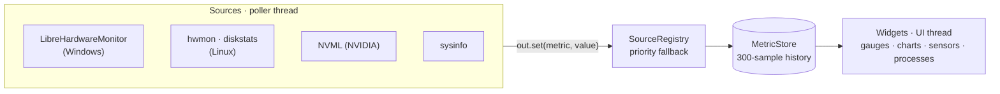
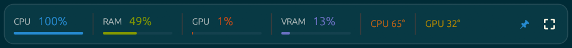
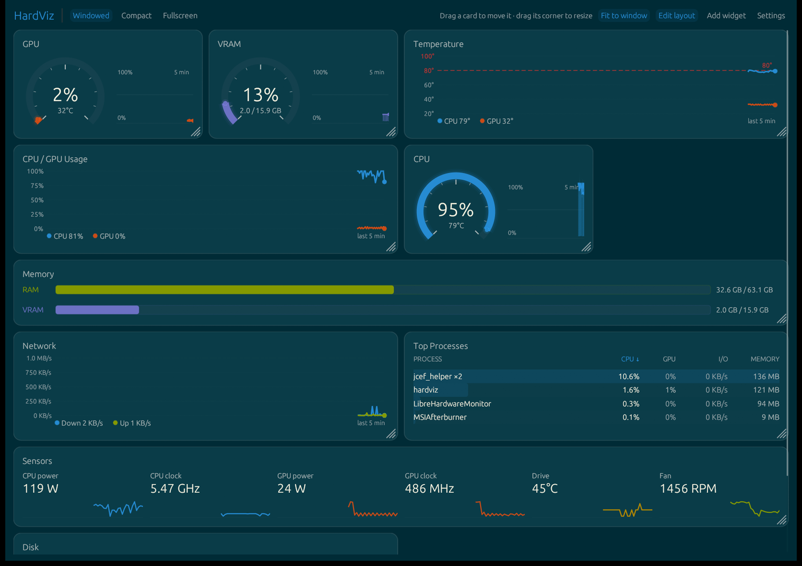
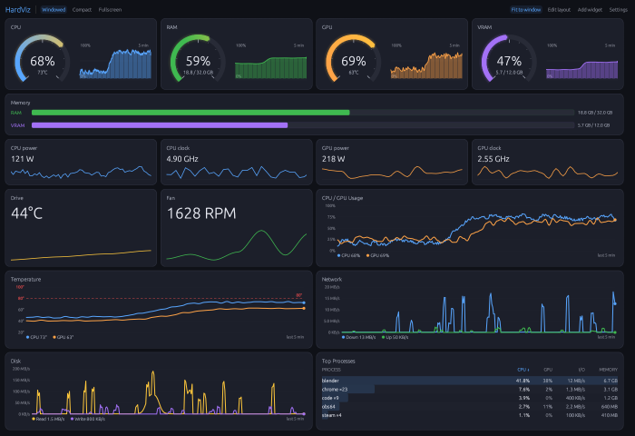
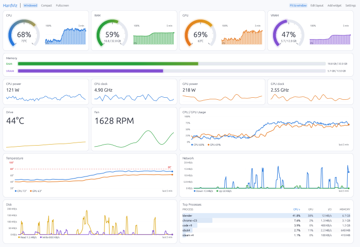
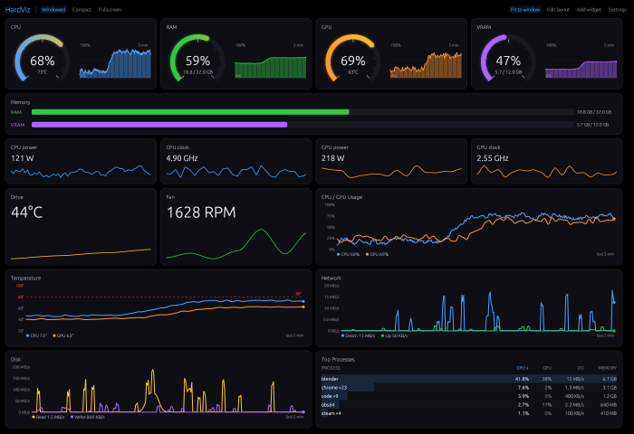
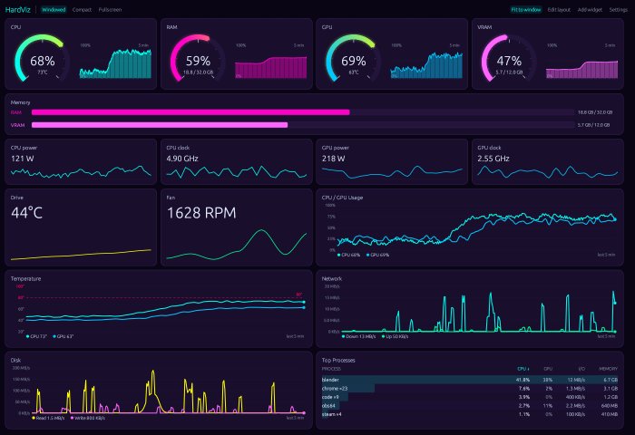
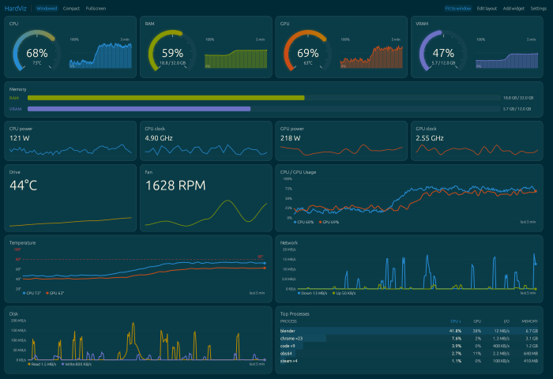
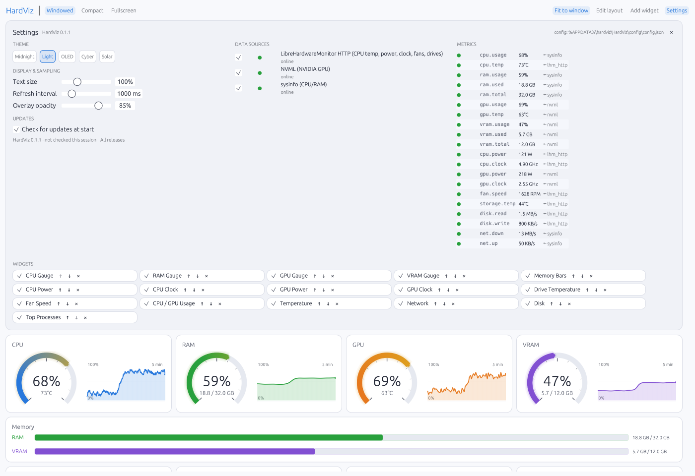

# HardViz

A hardware monitoring dashboard for Windows and Linux, built with Rust and
[egui](https://github.com/emilk/egui). Live CPU, RAM, GPU and VRAM gauges,
usage, temperature, network and disk charts, power/clock/fan/drive sensors, a
sortable top-processes list, five themes, and an always-on-top compact overlay
for keeping an eye on things while you work. A terminal version,
`hardviz-tui`, shows the same readings over SSH or in a console.

Everything is pluggable through two small registries: **sources** produce
metric readings, **widgets** consume them by id. Neither side knows about the
other, so adding a sensor automatically feeds every widget that asks for it,
and adding a widget works with whatever source happens to supply its metrics.




---

## Features

- **Gauges** — radial arc plus a 300-sample sparkline for CPU, RAM, GPU, VRAM.
- **Charts** — CPU/GPU utilisation, CPU/GPU temperature with an 80 °C
  threshold line, network down/up and disk read/write (auto-scaled), all on a
  fixed 5-minute window; RAM/VRAM capacity bars.
- **Sensors** — CPU/GPU power and clock, hottest drive temperature, fastest
  fan, each with a one-minute sparkline. Only sensors the machine reports are
  shown.
- **Top processes** — grouped by executable, sortable by CPU, GPU, I/O or
  memory (click a column header).
- **View modes** — windowed, OS-fullscreen, and a 640×96 compact overlay strip:
  borderless, drag anywhere to move, always-on-top toggle (📌), remembers its
  position, adjustable opacity.
- **Themes** — Midnight, Light, OLED Black, Cyberpunk, Solarized.
- **Customisable layout** — add any widget type as many times as you like,
  hide, reorder by drag-and-drop (behind a lock toggle) or with up/down buttons.
- **Background sampling** — readings are collected on a dedicated thread, so
  history keeps filling even when the window is occluded or unfocused.
- **Self-diagnosing** — an unavailable metric renders `N/A` with the reason and
  a hover explanation; it never renders a misleading zero.
- **Terminal UI** — `hardviz-tui`: the same sources and readings drawn in a
  terminal (usage panels, sensors, braille charts, sortable processes), in
  your theme's colours. See [Terminal UI](#terminal-ui).
- **Portable** — `build.rs` copies the bundled LibreHardwareMonitor next to the
  built executable, so the release folder runs standalone.

---

## Quick start

### Requirements

| | |
|---|---|
| Rust | 2021 edition toolchain (`rustup` stable) |
| Windows | MSVC toolchain; CPU temperature additionally needs LibreHardwareMonitor (bundled) |
| Linux | a C toolchain plus egui's windowing/GL libraries (see below); CPU temperature needs `k10temp`, `coretemp` or `zenpower` loaded (`lm-sensors`) |
| NVIDIA (optional) | A current driver — GPU/VRAM metrics come from NVML |

### Build and run

```sh
cargo run --release                     # the window
cargo run --release --bin hardviz-tui   # the terminal UI
```

On Debian/Ubuntu, install the build dependencies first:

```sh
sudo apt install build-essential pkg-config libxkbcommon-dev libwayland-dev libx11-dev libgl1-mesa-dev
```

Release builds land in `target/release/`:

```
target/release/
├── hardviz.exe
├── hardviz-tui.exe           # terminal UI
└── LibreHardwareMonitor/     # copied from vendor/ by build.rs (Windows only)
```

The `vendor/` → `target/<profile>/` copy is skipped when `vendor/` is absent and
on non-Windows targets. Files are re-copied only when the vendored one is newer,
so LHM settings changed in the running app (it rewrites its config on exit)
survive rebuilds.

Release profile is tuned for size and speed: `opt-level = "z"`, `lto`,
`codegen-units = 1`, `strip`.

### Tests

```sh
cargo test
```

Pure parsing and selection logic is unit tested: LHM `data.json` parsing and
the startup-task helpers (Windows), hwmon sensor picking and `/proc/diskstats`
(Linux), network adapter filtering and process ranking (both). The app itself
is exercised headlessly (frames run without a window), and
`tests/pipeline.rs` runs sources → poller → store → widgets end to end. Tests
never read or write your real config file.

The README screenshots are rendered the same way, from scripted demo data
rather than your machine, and rasterised on the CPU, so no window opens:

```sh
cargo test --lib readme_screenshots -- --ignored   # rewrites docs/images/*.png
```

### CI

`.github/workflows/ci.yml` does not run on ordinary commits. It runs when you
push a version tag, or when started by hand from the **Actions** tab
(**CI** → **Run workflow**):

```sh
git tag v0.2.0
git push origin v0.2.0
```

| Job | What it does |
|---|---|
| Format | `cargo fmt --check` (style in `rustfmt.toml`) |
| Clippy + test | `cargo clippy -- -D warnings` and `cargo test`, on Windows and Ubuntu (each compiles platform-only sources the other cannot) |
| Package | release builds of `hardviz` and `hardviz-tui`, downloadable from the run's **Artifacts** (Windows zip includes LibreHardwareMonitor) |
| GitHub release | on a `v*` tag only: publishes both packages as a release |

Run the same checks locally before pushing:

```sh
cargo fmt && cargo clippy --all-targets -- -D warnings && cargo test
```

---

## Usage

| Compact overlay (Solarized theme) — borderless, always on top, drag to move |
|---|
|  |

### Top bar

| Control | Action |
|---|---|
| `Windowed` / `Compact` / `Fullscreen` | switch view mode |
| `Fit to window` | scale card heights so the dashboard fills the window (on by default) |
| `Edit layout` | move, resize, restyle and remove cards (off by default so nothing changes by accident) |
| `Add widget` | open the **Add widget** panel — one button per registered widget type |
| `Settings` | open **Settings** |



In **Edit layout**, drag a card onto another to **swap** them (both glow
briefly), and drag the grip in a card's bottom-right corner to **resize** it:
width snaps to grid columns, height to 10 px steps. Double-click the grip (or
use ↺ on the card's chip in Settings → Widgets) to reset its size. Widgets are
also reorderable from Settings → Widgets with `↑` / `↓`.

### Keyboard shortcuts

| Key | Action |
|---|---|
| `F11` | toggle OS fullscreen |
| `Esc` | return to windowed (when not already windowed) |
| `W` | windowed |
| `C` | compact overlay |
| `F` | fullscreen |

`W` / `C` / `F` are ignored while a text field has focus and when Ctrl, Alt or
Cmd is held.

### Themes

Five presets, switched live from **Settings → Theme**:

| Midnight | Light | OLED Black |
|---|---|---|
|  |  |  |
| **Cyberpunk** | **Solarized** | |
|  |  | |

### Settings panel



Laid out in columns when the window is wide enough (General | Data sources |
Metrics), with the widget list as wrapping chips underneath.

- **Theme** — five presets.
- **Display & sampling** — text size, 80–150 % (scales all text); refresh
  interval, 250–5000 ms in 250 ms steps (default 1000 ms); compact overlay
  opacity, 30–100 % (default 85 %).
- **Data sources** — each registered source with a live/dot status, its reason
  when unavailable, the metrics it provides (hover), and a checkbox to disable
  it. Disabled sources are remembered across restarts. On Windows, a
  **Startup task** row sets up (or removes) a scheduled task that starts
  LibreHardwareMonitor at login without UAC prompts.
- **Metrics** — every metric in the catalogue with its current value and the
  source id currently feeding it (`← nvml`). Hover for the full diagnosis,
  including every source that claims the metric and why it is not winning.
- **Widgets** — one chip per card: visibility checkbox, name (hover for
  `type_id` and metric dependencies), reorder, reset size (when resized), remove.
- Header — the resolved config path.

### Layout behaviour

The dashboard is one grid of 4 columns. Each card spans 1–4 columns and has
its own height — its default comes from the widget (gauges 1 column, charts 2,
memory bars and sensors 4), and **Edit layout** lets you resize it. Cards are
packed into rows first-fit (each goes into the earliest row with room, so small
cards back-fill gaps) and stretch to their row's height. Every widget draws
into whatever size its card has: gauges switch to a side-by-side arc + history
layout in wide, short cards; charts, tables and sensor tiles scale with the card.

When the window narrows, the grid drops to 2 then 1 columns and spans scale
proportionally (stored in quarters, so a half-width card stays half-width).

**Fit to window** (top bar, on by default) scales all row heights by one factor
so the dashboard fills the window height — shrinking to each widget's minimum,
growing up to 1.6× — keeping your relative sizes. If even the minimums do not
fit, the page scrolls. With it off, cards keep their exact sizes. Settings and
the dashboard scroll together under a fixed top bar; opening Settings pushes the
dashboard down rather than squashing it.

### Compact overlay

Press `C` or click **Compact**. The strip is borderless — drag anywhere on it
to move it — and stays above other windows unless you turn off the 📌 toggle.
Its position and the always-on-top choice are saved; leaving compact mode puts
the normal window back where it was.

---

## Terminal UI


`hardviz-tui` is the dashboard for a terminal: over SSH, on a machine without
a desktop, or in a spare pane. It runs the same sources and poller as the
window, so every reading, fallback and `N/A` behaves identically.

```sh
hardviz-tui                              # from a release folder
cargo run --release --bin hardviz-tui    # from source
```

| Key | Action |
|---|---|
| `q` / `Esc` / `Ctrl+C` | quit |
| `c` `g` `i` `m` | sort processes by CPU / GPU / I/O / memory |
| `t` | next theme |
| `+` / `-` | refresh interval, 250–5000 ms |

- **Layout** — four usage panels (two by two below 100 columns), the sensors
  the machine reports, then temperature, network and disk charts and the
  process table as height allows. Works down to 80×24.
- **Config** — reads the window's saved config for its theme, refresh interval
  and disabled sources, but never writes it; theme and refresh changes last
  for the session.
- **Colours** — 24-bit, from the theme. Use a terminal with true colour
  (Windows Terminal, iTerm2, most Linux terminals); the legacy Windows console
  host approximates them.
- **Logging** — to `hardviz-tui.log` beside the window's log, never to the
  screen.
- On Windows it starts LibreHardwareMonitor exactly as the window does
  (including the startup task, if set up).

## Data sources

| id | Display name | Platform | Provides | Requirements |
|---|---|---|---|---|
| `lhm_http` | LibreHardwareMonitor HTTP | Windows | `cpu.temp`, `cpu.power`, `cpu.clock`, `fan.speed`, `storage.temp`, `disk.read`, `disk.write` | bundled LHM; started automatically (see below) |
| `acpi_thermal` | ACPI Thermal Zone (fallback CPU temp) | Windows | `cpu.temp` | `MSAcpi_ThermalZoneTemperature` present; often needs administrator rights |
| `hwmon` | Linux hwmon | non-Windows | `cpu.temp`, `storage.temp`, `fan.speed` | a CPU driver: `k10temp`, `zenpower`, `coretemp`, `cpu_thermal` |
| `diskstats` | Linux /proc/diskstats | Linux | `disk.read`, `disk.write` | none |
| `nvml` | NVML (NVIDIA GPU) | Windows, Linux | `gpu.usage`, `gpu.temp`, `gpu.power`, `gpu.clock`, `vram.usage`, `vram.used`, `vram.total` | NVIDIA driver |
| `sysinfo` | sysinfo | all | `cpu.usage`, `cpu.clock` (fallback), `ram.*`, `net.down`, `net.up` | none |

Not available: CPU power on Linux (reading RAPL energy counters needs root) and
per-process network traffic on either OS (needs admin rights or packet capture).
The process list's **I/O** column is what each OS reports per process: on
Windows disk, network and device I/O combined; on Linux disk only.

The order of `sources::default_sources()` is fallback priority. For a metric
supplied by several sources, the **earliest registered, enabled, online**
source that returns a value wins, which is what gives CPU temperature its
automatic LHM → ACPI → hwmon fallback chain. A source you disable in Settings
is never polled, so a disabled LHM is never launched.

### CPU temperature on Windows

Windows exposes no CPU temperature through `sysinfo`, and LibreHardwareMonitor
0.9.6 ships **no WMI provider** — the `root\LibreHardwareMonitor` namespace
simply does not exist in that build. It does publish an HTTP JSON endpoint, so
HardViz reads `http://127.0.0.1:8085/data.json`. The bundled LHM config already
has the web server on (bound to `127.0.0.1`) and starts minimised to the tray.

When the endpoint is unreachable at startup, HardViz starts the bundled LHM
itself, once per session:

- **With the startup task set up** (Settings → Data sources → Startup task →
  *Set up*, one UAC prompt): LHM starts at login with admin rights, and HardViz
  can also start it on demand through the task — no prompts ever again.
- **Without it:** HardViz launches LHM directly, and Windows shows a UAC prompt
  each time (LHM requires administrator rights).

LHM keeps running in the tray after HardViz closes. `acpi_thermal` takes over if
the board exposes ACPI thermal zones; most modern boards do not.

**Windows Security notifications** ("Protected memory access blocked …
LibreHardwareMonitor.exe"): Controlled folder access blocks LHM's raw-disk
reads, which it uses for drive health. CPU temperature is unaffected. To allow
it, add the exe under Windows Security → Ransomware protection → Allow an app.
Allowance is per path, so `target\debug\…` and `target\release\…` are separate
entries.

### CPU temperature on Linux

`sysinfo::Components` reads `/sys/class/hwmon`, so no daemon or root access is
needed — but the CPU driver must be loaded:

```sh
sensors            # is anything reported?
sudo sensors-detect
sudo modprobe k10temp    # AMD
sudo modprobe coretemp   # Intel
```

Sensor preference: a package/die sensor (`Package id 0`, `Tctl`, `Tdie`), else
the mean of per-core sensors, else any CPU-driver reading, else an `acpitz`
zone.

---

## Metrics

The catalogue lives in `src/metrics.rs`: one `metric::*` constant per metric,
listed in display order in `METRICS`.

| id | Label | Kind | Unit | Scale |
|---|---|---|---|---|
| `cpu.usage` | CPU | Cpu | % | 0–100 |
| `cpu.temp` | CPU | Cpu | °C | 20–100 |
| `ram.usage` | RAM | Ram | % | 0–100 |
| `ram.used` | RAM used | Ram | MB | — |
| `ram.total` | RAM total | Ram | MB | — |
| `gpu.usage` | GPU | Gpu | % | 0–100 |
| `gpu.temp` | GPU | Gpu | °C | 20–100 |
| `vram.usage` | VRAM | Vram | % | 0–100 |
| `vram.used` | VRAM used | Vram | MB | — |
| `vram.total` | VRAM total | Vram | MB | — |
| `cpu.power` | CPU power | Cpu | W | 0–200 |
| `cpu.clock` | CPU clock | Cpu | MHz | 0–6000 |
| `gpu.power` | GPU power | Gpu | W | 0–450 |
| `gpu.clock` | GPU clock | Gpu | MHz | 0–3200 |
| `fan.speed` | Fan (fastest) | Cooling | RPM | 0–3000 |
| `storage.temp` | Drive (hottest) | Storage | °C | 20–90 |
| `disk.read` / `disk.write` | Read / Write | Storage | MB/s | auto |
| `net.down` / `net.up` | Down / Up | Network | MB/s | auto |

Each entry's `scale` (`Scale::Fixed(lo, hi)` or `Scale::Auto(floor)`) sets a
chart's y axis, and its `Unit` the value and axis formatting (MB as GB above
1024 MB, MHz as GHz, rates as KB/s / MB/s / GB/s) — so charts and tiles need no
per-metric code.

## Widgets

| `type_id` | Display name | Size | Requires |
|---|---|---|---|
| `gauge.cpu` | CPU Gauge | Small | `cpu.usage` |
| `gauge.ram` | RAM Gauge | Small | `ram.usage` |
| `gauge.gpu` | GPU Gauge | Small | `gpu.usage` |
| `gauge.vram` | VRAM Gauge | Small | `vram.usage` |
| `chart.memory_bar` | Memory Bars | Wide | `ram.usage/used/total`, `vram.usage/used/total` |
| `chart.usage` | CPU / GPU Usage | Large | `cpu.usage`, `gpu.usage` |
| `chart.temperature` | Temperature | Large | `cpu.temp`, `gpu.temp` |
| `sensor.cpu_power` / `sensor.cpu_clock` | CPU Power / CPU Clock | Small | `cpu.power` / `cpu.clock` |
| `sensor.gpu_power` / `sensor.gpu_clock` | GPU Power / GPU Clock | Small | `gpu.power` / `gpu.clock` |
| `sensor.storage_temp` / `sensor.fan_speed` | Drive Temperature / Fan Speed | Small | `storage.temp` / `fan.speed` |
| `chart.network` | Network | Large | `net.down`, `net.up` |
| `chart.disk` | Disk | Large | `disk.read`, `disk.write` |
| `panel.processes` | Top Processes | Large | — (process list, sampled only while shown) |

New widget types are not added to an existing saved layout automatically; add
them with **Add widget**. A fresh install (or a deleted config) includes all of
them.

**Changing how a card shows its metric.** The gauges and the sensor cards show
one metric each, and each can be drawn as a **Gauge**, **Bar**, **Line chart**
or **Tile**: turn on **Edit layout** and pick from the menu in the card's top
right corner (or right-click the card). The choice is saved per card. In Edit
layout every card also has a **×** to remove it. Gauges and
bars span the metric's scale: 0–100 % for usage, a fixed range for
temperatures, and the busiest recent value (rounded up) for watts, clocks and
RPM. Layouts saved before the sensors were split get the six sensor cards in
place of the old Sensors strip.

Every chart is one `LineChartWidget` and every single-metric card one
`MetricWidget`, each configured by one entry in
`default_registry()` (`src/widgets/mod.rs`). A chart of any metrics is one more entry;
see [docs/adding-widgets.md](docs/adding-widgets.md).

> **Tip:** the same widget type can be added multiple times — each instance gets
> its own `uid` (`gauge.cpu#0`, `gauge.cpu#1`, …) and its own size.

---

## Configuration

Config is a single JSON file resolved by the
[`directories`](https://crates.io/crates/directories) crate from
`ProjectDirs::from("com", "hardviz", "HardViz")`:

- **Windows:** `C:\Users\<you>\AppData\Roaming\hardviz\HardViz\config\config.json`
- **Linux / macOS:** the platform config dir for the same qualifier

The authoritative path is printed at startup in the log (`config path: …`) and
shown in the Settings panel footer — check there rather than guessing.

It is rewritten every 30 polls and again on exit.

```jsonc
{
  "theme": "Solarized",              // MidnightDark | PureLight | OledBlack | Cyberpunk | Solarized
  "view_mode": "Windowed",           // Windowed | Compact | Fullscreen
  "widgets": [
    { "uid": "gauge.cpu#0", "type_id": "gauge.cpu", "visible": true },
    { "uid": "chart.usage#5", "type_id": "chart.usage", "visible": true,
      "span": 4, "height": 300 }       // resized: full width, 300 px (omitted = default)
  ],
  "window_width": 1100,
  "window_height": 780,
  "refresh_rate_ms": 1000,           // clamped to a 50 ms floor
  "overlay_opacity": 0.85,           // compact-mode alpha
  "disabled_sources": [],            // source ids turned off in Settings
  "widgets_locked": true,            // drag-to-reorder disabled
  "compact_always_on_top": true,     // compact overlay stays above other windows
  "compact_pos": [1500.0, 40.0],     // last compact overlay position (null = OS default)
  "font_scale": 1.0,                 // Settings -> Text size
  "fit_to_window": true              // scale card heights to the window
}
```

Widgets are stored as **instances referencing a registered `type_id`**, which is
what allows the same type to appear more than once. On load, entries whose
`type_id` is no longer registered are dropped, so removing a widget type in a
future version cannot corrupt a saved layout; if that empties the list, the
defaults are restored. Hand-editing is safe — delete the file for a factory
reset.

---

## Troubleshooting

The log is the first place to look. It is written to
`<config_dir>/hardviz.log` **and** stderr, truncated on each start so one run is
one file, and a panic hook records crashes that take the window with them.

| Symptom | Cause / fix |
|---|---|
| CPU temp shows `N/A` with "cannot reach http://127.0.0.1:8085/data.json" | LHM is not running or its Remote Web Server is off. See *CPU temperature on Windows*. |
| `N/A` with "MSAcpi_ThermalZoneTemperature returned 0 zone(s)" | ACPI fallback found no thermal zones — normal on modern boards. Use LHM. |
| `N/A` with "no CPU sensor among N hwmon reading(s)" (Linux) | CPU driver not loaded. `sudo modprobe k10temp` / `coretemp`, or run `sensors-detect`. In WSL this is expected: there are no hardware sensors. |
| A UAC prompt every time HardViz starts (Windows) | LHM is being launched directly. Set up the startup task in Settings → Data sources. |
| All GPU/VRAM metrics `N/A`, log says "NVML not available" | No NVIDIA driver, or an AMD/Intel GPU. NVML is the only GPU provider today. |
| A metric reads `N/A` but the source shows online | The source is up but returned `None` for that metric — hover the row in Settings → Metrics for the per-source diagnosis. |
| History looks gapped | A source dropped out for ≥3 consecutive polls; gaps are stored as `NaN` and drawn as breaks rather than lines to zero. |
| Charts are empty for the first seconds | History fills one sample per poll; 300 samples at 1 s is a 5-minute window. |
| Window is slow to update while unfocused | Sampling is on its own thread, so it is not; repaints are throttled by design when nothing is animating. |

`hardviz.log` also emits a health snapshot every 30 polls:

```
poll #30: cpu.usage=live/30, cpu.temp=none/0, gpu.usage=live/30, …
```

`live`/`none` is whether a value is currently held; the number after `/` is how
many history samples have accumulated.

---

## Project layout

```
hardviz/
├── build.rs              # bundles vendor/LibreHardwareMonitor next to the exe (Windows)
├── vendor/               # LibreHardwareMonitor (config + license tracked; binaries added locally)
├── tests/pipeline.rs     # end to end: sources -> poller -> store -> widgets, config <-> registry
└── src/
    ├── main.rs           # the window: calls startup::run
    ├── bin/hardviz-tui.rs # the terminal UI: calls tui::run
    ├── lib.rs            # crate root (everything else is a library, so it can be tested)
    ├── startup.rs        # window startup: logging, panic hook, config load, viewport
    ├── tui/              # terminal UI (ratatui): event loop, keys, and view.rs drawing
    ├── app/              # the UI shell
    │   ├── mod.rs        #   state, per-frame update, widget instances
    │   ├── dashboard.rs  #   card grid, drag-to-swap, resize grip
    │   ├── layout.rs     #   pure grid geometry (packing, fit to window, resize)
    │   ├── settings.rs   #   Settings panel
    │   ├── compact.rs    #   compact overlay
    │   ├── window.rs     #   view modes and the OS window
    │   ├── chrome.rs     #   top bar, shortcuts, Add widget panel
    │   └── style.rs      #   shared frames and buttons, egui visuals, fonts
    ├── config.rs         # persisted AppConfig (serde JSON), the app directory
    ├── metrics.rs        # metric catalogue, units, MetricStore (history + smoothing)
    ├── source.rs         # MetricSource trait, SourceRegistry, diagnostics
    ├── widget.rs         # Widget trait, WidgetCtx, WidgetRegistry
    ├── poller.rs         # background sampling thread and the state it publishes
    ├── processes.rs      # per-process sampling (CPU, GPU via NVML, I/O, memory)
    ├── nvidia.rs         # loading NVML (shared by the NVML source and processes)
    ├── theme.rs          # colour tokens, text scale, five presets
    ├── log.rs            # leveled file+stderr logger and info!/warn!/error! macros
    ├── sources/          # concrete MetricSource implementations
    │   ├── mod.rs        #   default_sources(): the priority order
    │   ├── sysinfo_source.rs
    │   ├── nvml.rs
    │   ├── lhm/          #   Windows: LibreHardwareMonitor
    │   │   ├── mod.rs    #     the source
    │   │   ├── http.rs   #     hand-rolled localhost HTTP GET
    │   │   ├── parse.rs  #     picking readings out of data.json
    │   │   ├── launch.rs #     starting LHM, UAC elevation
    │   │   └── task.rs   #     the login startup task
    │   ├── acpi.rs       #   Windows: WMI thermal zone on its own COM thread
    │   ├── hwmon.rs      #   Linux: temps via sysinfo::Components, fans via sysfs
    │   └── diskstats.rs  #   Linux: disk throughput from /proc/diskstats
    └── widgets/          # widget implementations
        ├── mod.rs        #   default_registry(), card frame, N/A placeholder
        ├── chart.rs      #   multi-series chart primitive, NaN-gap segments
        ├── line_chart.rs #   configurable chart: any metrics, one registry entry
        ├── gauge.rs      #   arc + history for any 0-100 % metric
        ├── metric.rs     #   one metric, user-chosen visual (gauge/bar/chart/tile)
        ├── bar.rs        #   bar visual
        ├── tile.rs       #   tile visual: value + 1-minute sparkline
        ├── processes.rs  #   sortable top-processes table
        └── memory_bar.rs
```

---

## Extending HardViz

Most extensions are a line or two:

| I want to… | Change | Read |
|---|---|---|
| chart, gauge or sensor-tile existing metrics | one entry in `default_registry()` (`widgets/mod.rs`) | [docs/adding-widgets.md](docs/adding-widgets.md) |
| add a reading an existing source can get | one `metric::*` constant + one `out.set(...)` | [docs/adding-sensors.md](docs/adding-sensors.md) |
| add a new backend (data source) | a `MetricSource` impl + one line in `default_sources()` | [docs/adding-sensors.md](docs/adding-sensors.md) |
| add a new kind of visualisation | a `Widget` impl (just `draw`) + one registry line | [docs/adding-widgets.md](docs/adding-widgets.md) |
| add or tweak a theme | a preset in `theme.rs` | [docs/adding-themes.md](docs/adding-themes.md) |
| understand threading, locks, layout and fit | — | [docs/architecture.md](docs/architecture.md) (with diagrams) |

---

## Dependencies

`eframe` / `egui` 0.29 (UI), `ratatui` 0.29 with crossterm (terminal UI), `sysinfo` 0.32 (CPU/RAM, hwmon), `nvml-wrapper`
0.10 (NVIDIA, incl. per-process GPU), `wmi` 0.13 (Windows ACPI fallback), `serde` + `serde_json`
(config, LHM parsing), `directories` 5 (config path), `chrono` 0.4 (log
timestamps).

### Bundled third-party binary

`vendor/LibreHardwareMonitor/` holds a redistributed copy of
[LibreHardwareMonitor](https://github.com/LibreHardwareMonitor/LibreHardwareMonitor)
0.9.6, used on Windows to read CPU temperature over its HTTP JSON endpoint.
Only its customised `LibreHardwareMonitor.config` and `LICENSE` are in git; to
bundle LHM, extract the 0.9.6 release into that folder, keeping the tracked
config, before building.

- License: **Mozilla Public License 2.0**. The full license text is included at
  `vendor/LibreHardwareMonitor/LICENSE` and is copied next to the executable by
  `build.rs`, so it ships with the release folder as MPL-2.0 requires.
- Copyright the LibreHardwareMonitor contributors. HardViz is not affiliated
  with, nor endorsed by, that project.
- The bundled `LibreHardwareMonitor.config` differs from upstream: it enables
  the remote web server bound to `127.0.0.1:8085` and starts minimised to the
  tray, which is what `sources/lhm/` reads.

The other bundled DLLs in that folder are LHM's own dependencies and are
covered by the same license terms.

