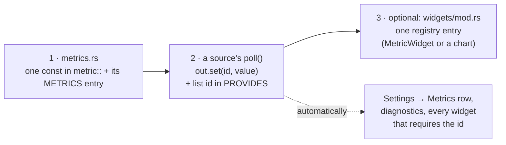
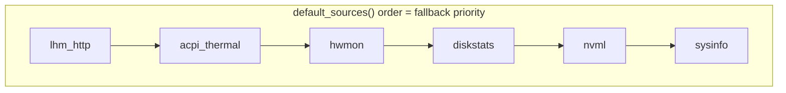

# Adding a sensor

A new reading takes two small edits, plus one line if you want a card for it:



If an existing source can read the value (LHM, NVML, sysinfo, hwmon, the macOS
SMC/IOReport/ioreg sources), you only
add a line to its `poll`. Write a new source only for a new backend.

## Worked example: GPU fan speed

**1 · Declare the metric** (`src/metrics.rs`): one constant carrying its
definition, and its place in the display order:

```rust
pub mod metric {
    // ...
    pub const GPU_FAN: MetricId = MetricId(&MetricDef {
        key: "gpu.fan", label: "GPU fan", kind: MetricKind::Gpu, unit: Unit::Percent, scale: Scale::Fixed(0.0, 100.0),
    });
}

pub const METRICS: &[MetricId] = &[
    // ...
    metric::GPU_FAN,
];
```

A `MetricId` can only be built in `metrics.rs`, so every id in the program has
a definition: `id.def().label` never fails.

**2 · Read it** in the NVML source (`src/sources/nvml.rs`): list it in
`PROVIDES`, then one line in `poll`:

```rust
const PROVIDES: &[MetricId] = &[
    // ...
    metric::GPU_FAN,
];

fn poll(&mut self, out: &mut Readings) {
    // ...
    out.set(metric::GPU_FAN, device.fan_speed(0).ok().map(|pct| pct as f64));
}
```

`out.set` takes an `Option`: when the query fails (a passively cooled card),
the metric is simply not written and the UI shows `N/A` with the reason —
never a fake `0`.

**3 · Show it** (`src/widgets/mod.rs`, `default_registry`), either as its own gauge…

```rust
WidgetFactory {
    type_id: "gauge.gpu_fan",
    display_name: "GPU Fan Gauge",
    default: false,
    build: || Box::new(MetricWidget::new(GPU_FAN, Visual::Gauge)),
},
```

…or in a chart with other metrics:

```rust
LineChartWidget::new("Cooling", &[FAN_SPEED, GPU_FAN])
```

A `MetricWidget` card can be switched by the user between gauge, bar, line
chart and tile; the visual passed to `new` is only the default.

That is the whole change. The metric also appears in Settings → Metrics with
its live value and provider.

## Part A — the metric

A `MetricDef` carries everything widgets need to display the metric, so they
need no per-metric code:

| Field | Used for |
|---|---|
| `key` | stable string key (`"gpu.fan"`), shown in Settings and logs; never rename |
| `label` | card title, chart legend |
| `kind` | colour: `theme.metric_color(kind)` (Cpu, Ram, Gpu, Vram, Storage, Network, Cooling) |
| `unit` | value formatting (`Unit::format`) and axis labels (`Unit::axis`) |
| `scale` | chart y axis: `Scale::Fixed(lo, hi)` or `Scale::Auto(floor)` (0 → busiest sample, 1-2-5 rounded, never below `floor`) |

Add a `Unit` variant only when none fits; give it both a `format` and an `axis`
arm. Add a `MetricKind` only for a new colour family, with a `metric_color` arm
in `theme.rs`.

## Part B — a new source

Write one when the reading comes from a backend no existing source talks to.

```rust
use crate::metrics::{metric, MetricId};
use crate::source::{MetricSource, Readings, SourceStatus};

const PROVIDES: &[MetricId] = &[metric::GPU_FAN];

pub struct MySource {
    status: SourceStatus,
}

impl MySource {
    /// Cheap and side-effect free: open devices, spawn workers or launch
    /// helpers lazily in the first `poll`, which never runs while disabled.
    pub fn new() -> Self {
        Self { status: SourceStatus::not_yet_polled() }
    }
}

impl MetricSource for MySource {
    fn id(&self) -> &'static str { "my_source" }                  // stable; persisted when disabled
    fn display_name(&self) -> &'static str { "My source (GPU fan)" }
    fn provides(&self) -> &'static [MetricId] { PROVIDES }

    fn poll(&mut self, out: &mut Readings) {
        match read_hardware() {
            Ok(v) => {
                out.set(metric::GPU_FAN, v);
                self.status = SourceStatus::Online;
            }
            // Say what the user can do about it — this text is shown in the UI.
            Err(e) => self.status = SourceStatus::Unavailable { reason: format!("cannot read the fan ({e})") },
        }
    }

    fn status(&self) -> SourceStatus { self.status.clone() }
}
```

The contract:

- `new()` is cheap and has no visible side effects. Do expensive or visible
  setup (loading a driver library, starting a worker thread, launching a
  helper) in the first `poll`: a source the user disabled is never polled.
- Start as `SourceStatus::not_yet_polled()`.
- `out` starts empty each poll. Write what you have; leave the rest unset.
- Write only ids listed in `provides()` — debug builds assert it.
- `poll` runs on the poller thread while it holds the registry lock (Settings
  waits on it): keep it fast and bounded, never panic on missing hardware. Slow
  work (WMI, big HTTP calls) belongs on a worker thread that `poll` copies from.
- Reject implausible values (a 0 °C or 400 °C "CPU temperature") instead of
  passing them on.

Add it in `src/sources/mod.rs` → `default_sources()` (or the platform's
`platform_sources()`). **Order is priority**: for a metric several sources
provide, the earliest one that writes a value wins. Gate platform-specific
sources with `#[cfg(...)]` on the `pub mod` and the function that lists them.
The poller builds the list on its own thread, so construction never blocks
the UI.



## Patterns that already cost someone a day

- **Windows COM/WMI: use a dedicated thread.** The UI thread is an STA
  (winit initialises COM that way); requesting MTA on it fails with
  `RPC_E_CHANGED_MODE`. `sources/acpi.rs` runs WMI on its own thread (started
  by the first poll, stopped by dropping a channel sender) and `poll` copies
  the latest result.
- **HTTP to localhost: hand-rolled is fine.** `sources/lhm/http.rs` does a blocking
  GET with a 350 ms timeout and `Connection: close`; a TLS-capable client crate
  would add size for nothing.
- **Several candidate sensors?** Prefer the most specific (package/die over
  per-core average over anything), document the preference, and unit test the
  picker as a pure function (`pick_cpu_temp`, `parse_readings`).
- **Linux hwmon.** `sysinfo::Components` covers temperatures; fans and other
  `*_input` files are read straight from `/sys/class/hwmon`. No root needed.
- **macOS: `ioreg` before FFI.** Registry properties need no `unsafe`:
  `sources/macos/ioreg.rs` runs `/usr/sbin/ioreg -r -d 1 -c <class>` (about
  15 ms) and pulls `"key"=number` pairs out of its text; `ioreport.rs` reads
  the DVFS tables the same way. FFI is only for what the registry does not
  hold: SMC keys (`smc.rs`) and IOReport samples (`ioreport.rs`).
- **macOS private interfaces lie quietly.** Unused SMC keys read -4 °C or 0,
  sysinfo's PMU channels about -9200 °C, and IOReport's CPU energy counter is
  frozen for non-root readers on recent releases. Filter by range, and treat
  a counter that never moves as unavailable rather than as zero.
- **sysinfo on Windows: one `System` per kind of CPU refresh.** Refreshing CPU
  frequency on the `System` that measures CPU usage corrupts the usage
  (sysinfo 0.32): it reads at or near 100% regardless of load.
  `sysinfo_source.rs` keeps a second `System` for clocks. Check any new CPU
  reading against Task Manager or `typeperf "\Processor(_Total)\% Processor Time"`.
- **Rates.** Store a delta over the *measured* elapsed time (`Instant`), not
  the configured interval, and skip the first sample after a reset rather than
  plotting a since-boot total as one huge spike.

## Verify

1. `cargo test`, `cargo run`.
2. Settings → Data sources: your source is listed and `online` (or shows its
   reason). Settings → Metrics: the metric has a value and `← your_source`.
3. Unplug / disable the hardware: the metric goes `N/A` after 3 polls and the
   hover text explains why.

## Troubleshooting

| Symptom | Cause |
|---|---|
| Panic: "wrote metrics it does not declare" (debug) | add the id to `PROVIDES` |
| Metric never appears in Settings → Metrics | its constant is not listed in `METRICS` |
| Shows another source's value | an earlier-registered source also provides it; that one wins |
| Value freezes, then `N/A` | your `poll` stopped writing it — expected after 3 misses |
| UI stutters each sample | `poll` is slow; move the work to a worker thread |
