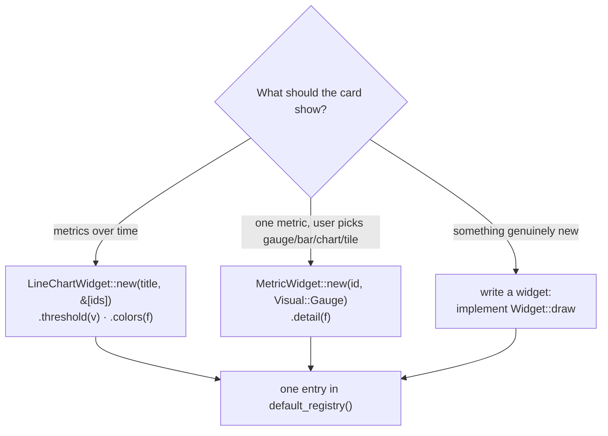
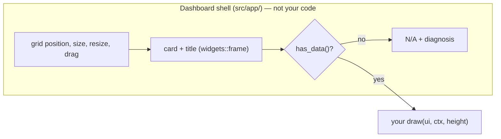

# Adding a widget

Most new cards need no new code, just an entry in `default_registry()`
(`src/widgets/mod.rs`) using one of the configurable widgets:



## Registering a card

Each entry is a `WidgetFactory`:

```rust
WidgetFactory {
    type_id: "chart.temperature",
    display_name: "Temperature",
    default: true,
    build: || Box::new(LineChartWidget::new("Temperature", &[CPU_TEMP, GPU_TEMP]).threshold(80.0)),
},
```

- **`type_id`** is persisted in `config.json`. Never change an existing one,
  or saved layouts lose that card. Convention: `gauge.*`, `chart.*`, `panel.*`.
- **`default`** `true` adds the card on fresh installs (and after a
  config reset). Existing layouts are never changed; users add it with
  **Add widget**.
- The registry order is the default layout order and the Add widget order.

It then appears in Add widget, persists, can be resized, reordered and hidden,
and shows `N/A` with a reason when its metrics have no data — all without code.

### The configurable widgets

| Widget | Takes | Notes |
|---|---|---|
| `LineChartWidget` | title, metric ids | Axis scale, unit and legend labels come from the first metric's `MetricDef`. Series with no data are left out and named in a hover note. `.threshold(v)` draws a dashed danger line; `.colors(\|t\| vec![..])` when metrics share a colour kind (network down/up). |
| `MetricWidget` | one metric id, starting `Visual` | The card for a single metric. The user switches it between `Gauge`, `Bar`, `Chart` and `Tile` (Edit layout's card menu, or right-click); the choice is saved per card (`WidgetInstance::visual`). `.detail(..)` is passed to the gauge. Use this for any new single-metric card. |
| `GaugeWidget` | one metric id | Arc + 5-minute history over the metric's scale, value in its unit. Switches to side-by-side layout in wide, short cards. `.detail(\|ctx\| ..)` sets the line under the percentage; helpers `GaugeWidget::temperature(ctx, id)` and `GaugeWidget::used_of(ctx, used, total)`. |
| `BarWidget`, `TileWidget` | one metric id | The bar and tile visuals: value plus a bar across the scale; value plus a 1-minute sparkline scaled to its own range. |

A widget offers visuals by returning `Some` from `Widget::visual` and
rebuilding itself in `Widget::set_visual`; the shell adds the Edit layout
menu and the right-click menu. Retiring a `type_id` (as `panel.sensors` was) is done by
listing its replacements in `widgets::REPLACED_TYPES`, so saved layouts are
migrated instead of losing the card.

Examples:

```rust
WidgetFactory {
    type_id: "chart.power",
    display_name: "Power",
    default: false,
    build: || Box::new(LineChartWidget::new("Power", &[CPU_POWER, GPU_POWER])),
},
WidgetFactory {
    type_id: "gauge.gpu",
    display_name: "GPU Gauge",
    default: true,
    build: || Box::new(GaugeWidget::new(GPU_USAGE).detail(|ctx| GaugeWidget::temperature(ctx, GPU_TEMP))),
},
```

Need a metric that does not exist yet? See [adding-sensors.md](adding-sensors.md).

## Writing a new widget

Only for a new kind of visualisation (the memory bars and the process table
are examples). The dashboard already does the shared work:



So a widget implements only what is specific to it:

```rust
use crate::metrics::{metric, MetricId};
use crate::widget::{Card, Widget, WidgetCtx, WidgetSize};
use egui::{Sense, Ui, Vec2};

pub struct FanBarsWidget {
    fans: Vec<MetricId>,
}

impl Widget for FanBarsWidget {
    fn title(&self) -> &str { "Fans" }
    fn requires(&self) -> &[MetricId] { &self.fans }      // drives the automatic N/A
    // Default width (Small 1, Large 2, Wide 4 columns), height (whole card,
    // title included) and the minimum Fit to window never shrinks below.
    fn card(&self) -> Card { Card::new(WidgetSize::Large, 160.0, 110.0) }

    fn draw(&mut self, ui: &mut Ui, ctx: &WidgetCtx, height: f32) {
        // `ui` is exactly the content area under the title; size from it.
        let (rect, _) = ui.allocate_exact_size(Vec2::new(ui.available_width(), height), Sense::hover());
        let painter = ui.painter_at(rect);
        for &id in &self.fans {
            let Some(rpm) = ctx.value(id) else { continue };  // eased value; None = unavailable
            // ... paint with ctx.theme colours and ctx.theme.font(size)
        }
    }
}
```

Put it in `src/widgets/`, add `pub mod` in `src/widgets/mod.rs`, and register
it as above. `ctx` also has `raw(id)`, `history(id)`, `has_history(id)`,
`diagnosis(id)` and `processes`.

### Rules

- **Draw into the area you are given.** The user can resize the card and Fit to
  window rescales it; take sizes from `ui.available_width()` and `height`,
  never constants. Test it small and large.
- **Fonts go through `theme.font(size)` / `theme.fs(size)`** so the Text size
  setting reaches them.
- **Colours come from `ctx.theme`** (`metric_color(kind)`, `text_muted`,
  `danger`…) so all five themes work.
- **`None` is not zero.** `ctx.value(id)` / `ctx.raw(id)` return `None` when a
  metric is unavailable; history uses `NaN` for gaps — break lines there.
- **Override `has_data`** only if the default ("some required metric has
  history") is wrong for you — the gauge needs a *current* value, so it does.
- **`wants_processes() -> true`** if you read `ctx.processes`; sampling runs
  only while such a widget is visible.
- **Animating?** Extend `is_animating()` in `src/app/mod.rs`, or you repaint only once
  per sample.

Useful helpers in `crate::widgets`: `chart::draw_chart` (the multi-series chart
primitive), `metrics::Scale::range`, `chart::time_segments` (NaN-gap polylines), `window_label`, `clip_chars`,
and `crate::theme::with_alpha`.

## Verify

1. `cargo run` → **Add widget** → your card appears.
2. **Edit layout**: resize it small and large, and toggle **Fit to window**.
3. Disable its source in Settings → Data sources: the card shows `N/A` with
   the reason.
4. Cycle the five themes and a couple of text sizes.
