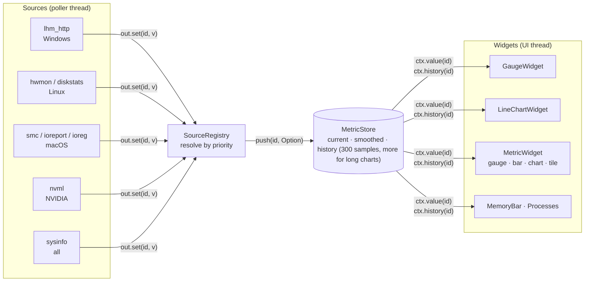
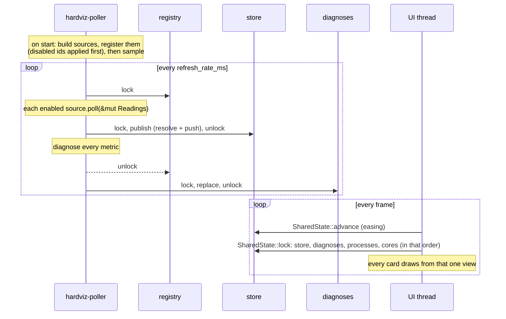
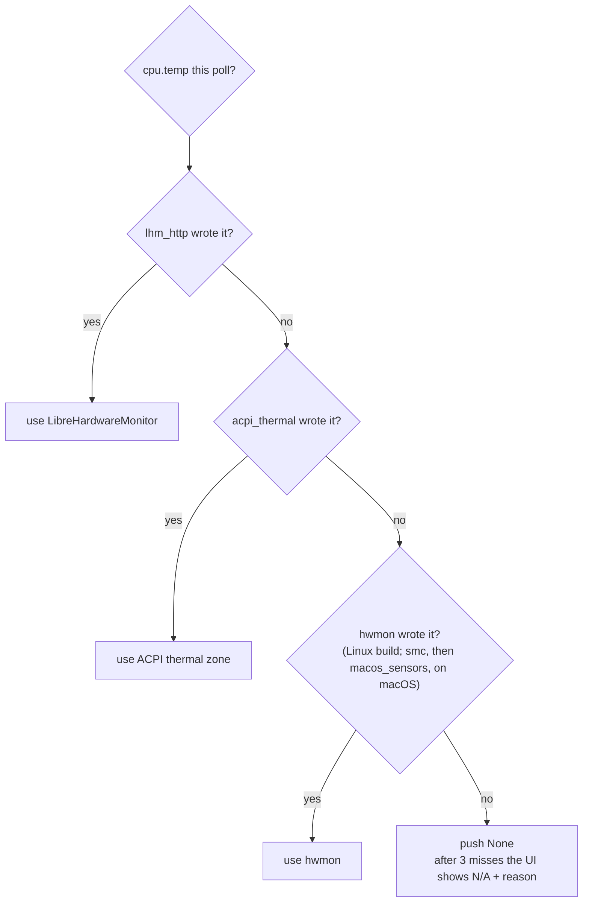
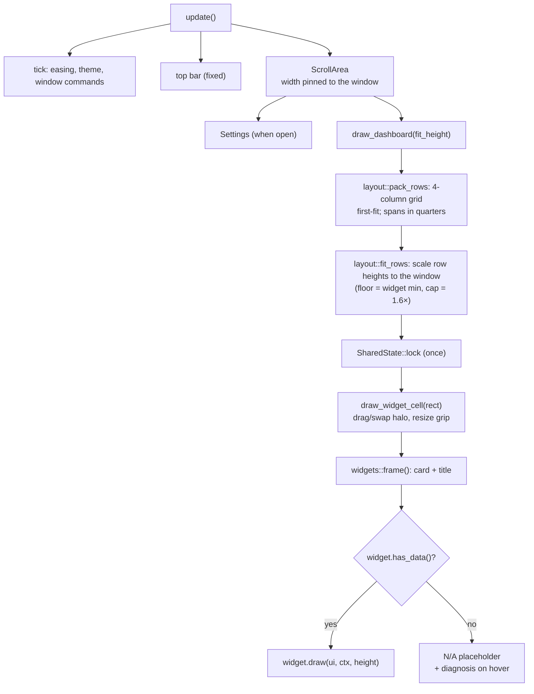

# Architecture

How HardViz is put together, and the invariants that keep it working. Read
this before changing threading, the store, or the layout. To *add* things, the
two how-to guides are shorter: [adding-sensors.md](adding-sensors.md) and
[adding-widgets.md](adding-widgets.md).

## The one idea

Everything flows through a **metric id** (`MetricId`), one of the constants in
`metrics::metric` such as `CPU_TEMP` (key `"cpu.temp"`). Sources *provide*
metric ids, widgets *require* them, and neither knows the other exists.

Adding a sensor makes it available to every widget that asks for its id; adding
a widget works with whichever source supplies its ids. A `MetricId` can only be
created in `metrics.rs`, and it carries its definition (label, unit, colour
kind, axis scale), so `id.def()` cannot fail.

## Threading

Two threads. The poller owns sampling; the UI only reads what it publishes.
Shared state lives in `poller.rs` and is reached only through `Poller` methods:

| State | Contents | Written by | Read by |
|---|---|---|---|
| source registry | `SourceRegistry` (sources, their latest `Readings`, disabled ids) | poller; `set_source_enabled` | `Poller::source_infos` (Settings) |
| store | `MetricStore` | poller (`publish`), UI (`advance`) | widgets, via `SharedState::lock` |
| diagnoses | `Diagnoses` (`HashMap<MetricId, MetricDiagnosis>`) | poller | widgets, Settings |
| processes | `Vec<ProcRow>` (top processes) | poller, only while wanted | Top Processes widget |
| cores | `Vec<f32>` (per-core CPU usage) | poller, only while wanted | Per-Core CPU widget |

### Why sampling is not on the UI thread

`eframe::App::update` only runs when egui repaints, and winit throttles
repaints for occluded or unfocused windows (30 one-second polls take over
100 s while the window is covered). **Put new sampling work in a
`MetricSource::poll`, never in `update`.**

### Locks

- The poller takes registry → store, and registry → diagnoses, never store and
  diagnoses together. Sources do their I/O holding **only** the registry lock,
  so a slow source never blocks rendering.
- The UI reads store, diagnoses, processes and cores only through
  `SharedState::lock`, which takes them in that fixed order, once per frame
  for the whole dashboard.
- The registry is touched by the UI only through `Poller::source_infos` and
  `Poller::set_source_enabled`, which hold nothing else.

So no two threads can wait on each other. Consequences:

1. **`poll` holds the registry lock.** A slow poll delays Settings' source
   list. Keep `poll` bounded (`sources/lhm/http.rs` uses a 350 ms socket
   timeout) and move anything slower to a worker thread that `poll` only
   copies from (`sources/acpi.rs` is the reference).
2. **A frame holds the store for its duration**; the poller waits at most one
   frame to publish, and its schedule is unaffected.
3. **Process sampling is opt-in.** Enumerating every process is the costliest
   sample, so the poller does it (every 2 s) only while a visible widget's
   `wants_processes()` is true. Per-core sampling is opt-in the same way
   (`wants_cores()`), but cheap enough to run at the metric cadence.

### Startup and the poller loop

`Poller::spawn(default_sources, &disabled, interval)` starts the thread, which
builds the source list there (constructors are cheap; sources do real setup on
their first poll) and registers it with the user's disabled ids already
applied. **A disabled source is never polled**, so it has no side effects, such
as LHM launching with a UAC prompt.

The thread sleeps on a channel until the next sample or process refresh, so
`set_interval` and dropping the `Poller` take effect at once. Samples run on a
fixed-rate schedule (each is due one interval after the previous one was *due*),
so time spent sampling does not stretch the period. After each publish the
poller calls the `on_publish` callback; both front ends use it to repaint, so
a sample is drawn as it lands rather than on a UI timer that drifts against
the poller. `poll_count()` is
a monotonic counter; the app checks the config for changes and the poller logs
a health line every 30 polls.

## Source resolution

Each poll, every enabled source writes the values it has into its own
`Readings` (a map that starts empty). Then, for each metric, the **earliest
registered, enabled, online source that wrote a value** wins. The order of
`sources::default_sources()` is therefore fallback priority:

The same rule gives `cpu.clock` LHM's live average on Windows with sysinfo as
the fallback. In debug builds the registry asserts that a source only writes
ids it lists in `provides()`, so an undeclared metric fails loudly. These rules
are unit tested in `source.rs` and end to end in `tests/pipeline.rs`.

**Derived metrics** (`metrics::RATE_TOTALS`, the session totals) are the one
exception to "a source provides every metric": no source claims them, the
registry skips them when publishing, and the store integrates them from their
rate metric instead (see below). Their diagnosis names `hardviz` as the
provider.

## MetricStore semantics

One series per catalogue metric:

| Method | Called by | Behaviour |
|---|---|---|
| `push(id, Option<f64>)` | poller, once per metric per poll | `Some(v)` appends to history. `None` counts a miss; after `STALE_AFTER = 3` consecutive misses, `current` becomes `None` and `NaN` is appended |
| `integrate(dt_secs)` | poller, once per poll, inside `publish` | accumulates each rate in `RATE_TOTALS` into its session total over the real elapsed time; a stale rate adds nothing, and the total itself never goes stale |
| `advance(dt, rate)` | UI, once per frame | exponential ease toward `current`, frame-rate independent |
| `smoothed(id)` → `ctx.value()` | widgets | eased value, `None` when unavailable |
| `current(id)` → `ctx.raw()` | widgets | latest raw reading |
| `history(id)` → `ctx.history()` | gauges, bars, tiles, sparklines | oldest first, the last ≤ 300 samples, `NaN` = gap |
| `long_history(id)` → `ctx.long_history()` | line charts | the same, up to `capacity()` samples: enough for the chart time span at the refresh interval (`set_capacity`, at most 1 h at 250 ms) |

Decisions that are easy to undo by accident:

- **History is a `Vec`, not a `VecDeque`**: `history()` returns one slice,
  which a wrapped deque cannot provide. It grows to twice the capacity before
  the oldest half is dropped in one move, so a 14 400-sample history is not
  shifted on every poll.
- **Long charts average into buckets fixed to absolute sample positions**
  (`chart::bucket_means`, anchored by `appended(id)`), so an older point keeps
  its value as new samples arrive and the line does not shimmer.
- **Missing samples are `NaN`, never `0`**, and every renderer breaks the line
  there (`widgets::chart::time_segments`), so a dropped reading never draws a
  line down to zero.
- **Smoothing lives in the store**, so every widget eases identically.

## Rendering pipeline

The UI shell (`src/app/`) owns everything widgets have in common, so a widget
only paints content:

- **Grid.** One grid of 4 columns (2 or 1 on narrow windows; never 3, because
  spans are stored in quarters). Each card's span and height come from the
  config (`WidgetInstance::span/height`) or the widget's defaults
  (`card()`: size class, default height). Cards in a row stretch to
  the tallest one. The geometry is pure and unit tested (`app/layout.rs`).
- **Fit to window.** `fit_rows` scales all rows by one factor so the dashboard
  fills the viewport: shrinking stops at each row's `card().min_height` (then the
  page scrolls), growing stops at 1.6×. Stored heights stay unscaled, so the
  user's relative sizes are kept and the resize grip divides by the factor.
- **Width.** Size from the visible width (`ui.clip_rect()`), never from content
  width: a vertical scroll area remembers its content width, so sizing from it
  lets one over-wide frame keep everything too wide.
- **Text size.** The `Theme` carries the text scale; every size goes through
  `theme.fs()` / `theme.font()`, and egui's built-in text styles are scaled to
  match (`app/style.rs`).
- **Window.** View-mode switches queue viewport commands (`app/window.rs`);
  while windowed, the window's size is kept in the config, so leaving compact
  or fullscreen restores it.

### Repaint policy

Repaints run at 33 ms (30 fps) while something animates (swap glow, dragging, a
value still easing by more than 0.5% of its range) and at `refresh_rate_ms` otherwise. **A widget
with its own animation must extend `is_animating()`** (`app/mod.rs`), or it
only advances once per sample.

## Configuration

`AppConfig` (`config.rs`, serde JSON) loads once at startup; every 30 polls
and on exit it is serialized and compared with the last save, and written
only when it changed, atomically (temp file + rename). Widgets are stored as
instances (`uid`, `type_id`, `visible`, optional `span` / `height`). On load,
instances whose `type_id` is not registered are dropped, so removing a widget
type cannot corrupt a saved layout; `config.rs` gets the known and default
type ids from the widget registry (`WidgetTypes`) rather than importing it. A
missing file means defaults; a file that cannot be parsed is renamed to
`config.json.bak` and logged before defaults are used, so it is never silently
overwritten. Every field added since the first release has a serde default, so
old files load.

The window also holds a single-instance lock (`startup.rs`): an OS lock on
`<config_dir>/hardviz.lock`, released by the OS when the process exits. A
second window shows a notice instead of starting; the terminal UI is not
guarded, since it never writes the config.

## Module map

| Path | Responsibility |
|---|---|
| `main.rs`, `startup.rs` | logger, panic hook, single-instance lock, config load, viewport, `run_native` |
| `lib.rs` | the crate root; everything below is a library, tested in `tests/` |
| `bin/hardviz-tui.rs`, `tui/` | the terminal front end: ratatui event loop and keys (`mod.rs`), a pure `draw` of store + processes (`view.rs`); same `Poller` and sources as the window, config read-only |
| `app/mod.rs` | shell state, per-frame update, widget instances |
| `app/{chrome,dashboard,settings,compact}.rs` | top bar and shortcuts, card grid, Settings panel, compact overlay |
| `app/layout.rs` | pure grid geometry: packing, fit to window, resize |
| `app/window.rs` | view modes, viewport commands, window geometry |
| `app/style.rs` | shared frames and buttons, egui visuals, fonts |
| `poller.rs` | sampling thread, `SharedState`, process and per-core sampling on demand |
| `metrics/` | catalogue (`metric::*`, `METRICS`, `RATE_TOTALS`), `Unit`, `Scale`, `MetricKind`, `MetricStore` |
| `source.rs` | `MetricSource`, `Readings`, `SourceRegistry`, resolution, diagnostics |
| `widget.rs` | `Widget`, `WidgetCtx`, `WidgetRegistry` |
| `widgets/mod.rs` | `default_registry()` (every widget type), card frame, N/A placeholder |
| `widgets/*.rs` | `chart` (chart primitive, `time_segments`, hover crosshair) and the configurable widgets |
| `processes.rs` | per-process CPU / GPU / I/O / memory sampling and ranking |
| `cores.rs` | per-core CPU sampling for the Per-Core CPU card |
| `export.rs` | history export: pure CSV builder + the timestamped file next to the config |
| `nvidia.rs` | loading NVML, shared by the NVML source and process sampling |
| `config.rs` | persisted `AppConfig`, the app directory |
| `update.rs` | the running version; the background release check started with the app |
| `theme.rs` | colour tokens, text scale, five presets, `ThemeName` |
| `log.rs` | leveled file + stderr logger (file only for the terminal UI) |
| `sources/mod.rs` | `default_sources()`: the priority order |
| `sources/lhm/` | Windows: LHM over HTTP (`http`, `parse`), starting it (`launch`), its startup task (`task`) |
| `sources/macos/` | macOS: SMC temperatures and fans (`smc`), IOReport clocks and power (`ioreport`), sysinfo sensors (`sensors`), I/O Kit disk/GPU counters (`ioreg`) |

## Invariants worth preserving

1. Widgets never touch a source; sources never touch a widget.
2. `None` means unavailable, `0` means zero. A source leaves a metric unset
   rather than writing a placeholder.
3. Missing history samples are `NaN`, and every renderer breaks the line there.
4. Shared state is reached through `Poller` / `SharedState`, which keep the
   lock order; source I/O never holds the store.
5. Source constructors are cheap; `poll()` is bounded, never panics on missing
   hardware, and never runs for a disabled source.
6. Every metric is a `metric::*` constant listed in `METRICS`; every widget
   type is in `widgets::default_registry()`.
7. Metric keys and widget `type_id`s are stable: `type_id`s are persisted in
   `config.json`, and keys appear in logs and Settings.
8. Widgets size themselves from the area they are given; the shell owns the
   card, title and N/A state.
