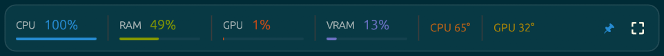
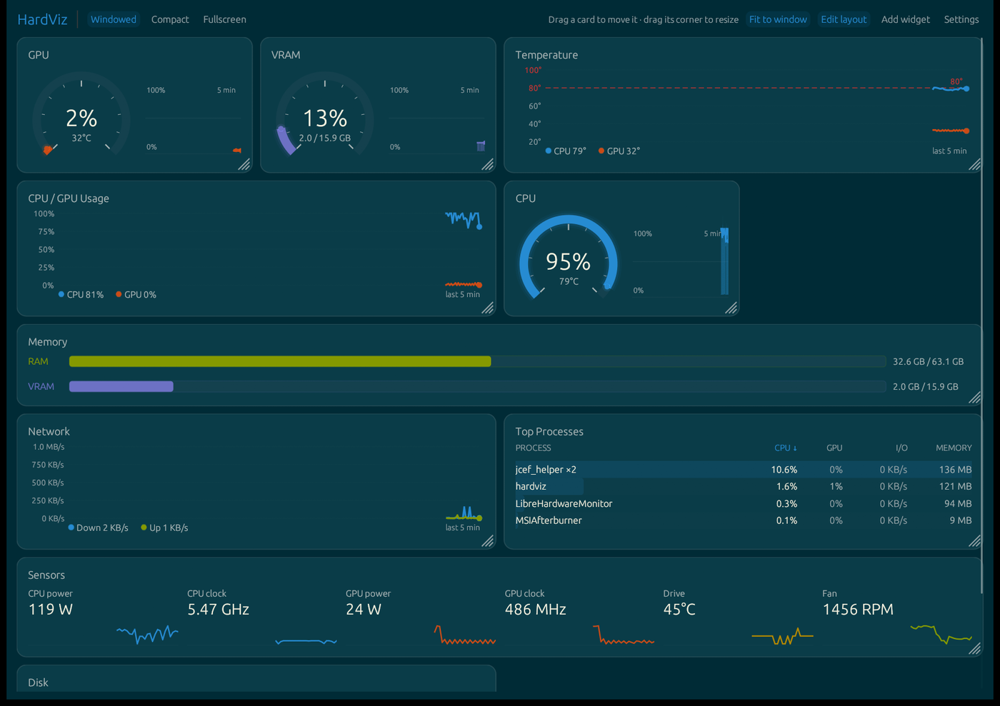
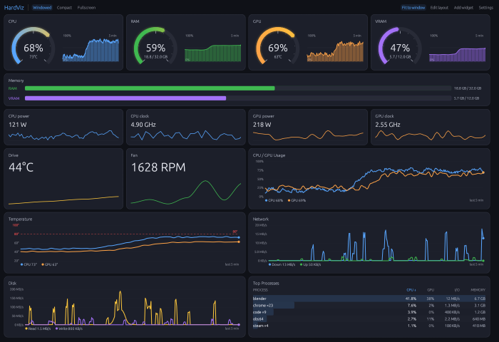
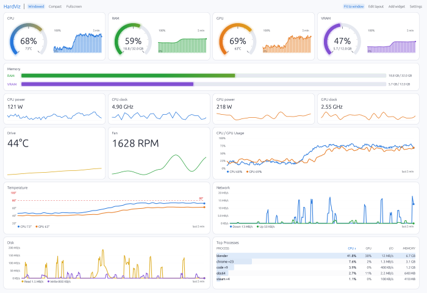
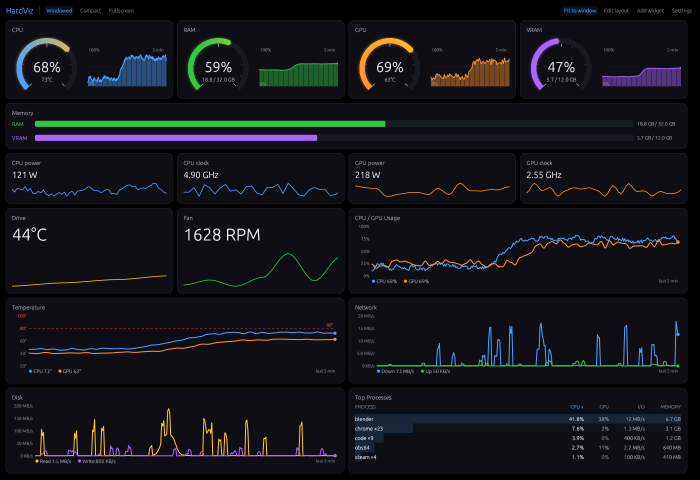
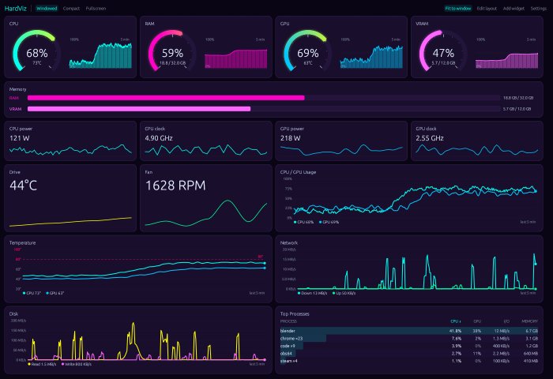
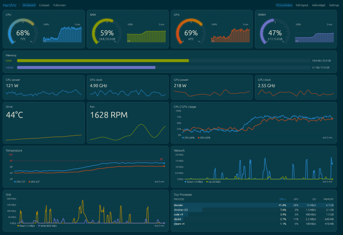
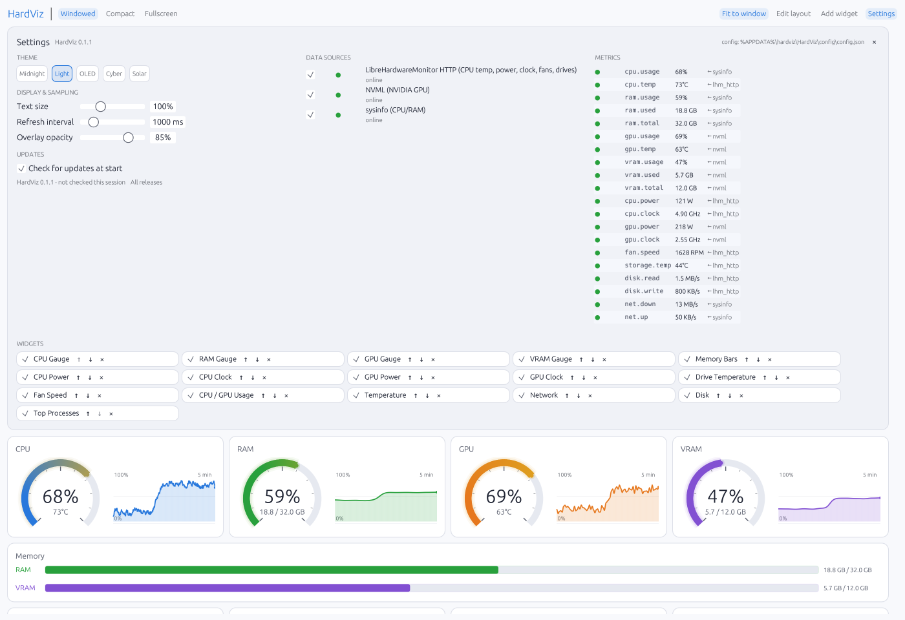

# Using HardViz

Everything is reachable from the top bar; nothing is hidden behind a
right-click you would never find. This page covers the window and the terminal
UI. For where readings come from, see [data-sources.md](data-sources.md).

| Compact overlay (Solarized theme) — borderless, always on top, drag to move |
|---|
|  |

---

## Top bar

| Control | Action |
|---|---|
| `Windowed` / `Compact` / `Fullscreen` | switch view mode |
| `Fit to window` | scale card heights so the dashboard fills the window (on by default) |
| `Edit layout` | move, resize, restyle and remove cards (off by default so nothing changes by accident) |
| `Add widget` | open the **Add widget** panel — one button per registered widget type |
| `Settings` | open **Settings** |
| `↑ Update x.y.z` | shown only when a newer release exists; opens its release page (see [Updates](#updates)) |



In **Edit layout**, drag a card onto another to **swap** them (both glow
briefly), and drag the grip in a card's bottom-right corner to **resize** it:
width snaps to grid columns, height to 10 px steps. Double-click the grip (or
use ↺ on the card's chip in Settings → Widgets) to reset its size. Widgets are
also reorderable from Settings → Widgets with `↑` / `↓`.

## Keyboard shortcuts

| Key | Action |
|---|---|
| `F11` | toggle OS fullscreen |
| `Esc` | return to windowed (when not already windowed) |
| `W` | windowed |
| `C` | compact overlay |
| `F` | fullscreen |

`W` / `C` / `F` are ignored while a text field has focus and when Ctrl, Alt or
Cmd is held.

## Compact overlay

Press `C` or click **Compact**. The strip is borderless — drag anywhere on it
to move it — and stays above other windows unless you turn off the 📌 toggle.
Its position and the always-on-top choice are saved; leaving compact mode puts
the normal window back where it was. Opacity is adjustable in Settings
(30–100 %, default 85 %).

## Themes

Five presets, switched live from **Settings → Theme**:

| Midnight | Light | OLED Black |
|---|---|---|
|  |  |  |
| **Cyberpunk** | **Solarized** | |
|  |  | |

Text size (80–150 %) is a separate setting and scales every label, including
the ones inside charts. Want a sixth theme? See
[adding-themes.md](adding-themes.md).

## Settings panel



Laid out in columns when the window is wide enough (General | Data sources |
Metrics), with the widget list as wrapping chips underneath.

- **Theme** — five presets.
- **Display & sampling** — text size, 80–150 % (scales all text); refresh
  interval, 250–5000 ms in 250 ms steps (default 1000 ms); compact overlay
  opacity, 30–100 % (default 85 %).
- **Data sources** — each registered source with a live/dot status, its reason
  when unavailable, the metrics it provides (hover), and a checkbox to disable
  it. Disabled sources are remembered across restarts, and a disabled source is
  never polled — so a disabled LibreHardwareMonitor is never launched. On
  Windows, a **Startup task** row sets up (or removes) a scheduled task that
  starts LibreHardwareMonitor at login without UAC prompts.
- **Metrics** — every metric in the catalogue with its current value and the
  source id currently feeding it (`← nvml`). Hover for the full diagnosis,
  including every source that claims the metric and why it is not winning.
- **Widgets** — one chip per card: visibility checkbox, name (hover for
  `type_id` and metric dependencies), reorder, reset size (when resized), remove.
- **Updates** — the running version, whether it is the latest, a link to a
  newer release when there is one, and the *Check for updates at start*
  checkbox. See [Updates](#updates).
- Header — the running version and the resolved config path (see
  [configuration.md](configuration.md)).

## Updates

At start, HardViz asks GitHub once for its latest release (on a background
thread, through the system `curl`, which ships with macOS, Windows 10+ and
nearly every Linux desktop). When a newer version exists, a small
**↑ Update x.y.z** link appears in the top bar and in Settings → Updates; it
opens the release page. Nothing is downloaded or installed, and there are no
pop-ups. The terminal UI shows the same notice in its title line.

The request is a plain `GET` of
`api.github.com/repos/liorbass/hardviz/releases/latest` with the user agent
`HardViz/<version>`; nothing about you or the computer is sent. A failed check
(offline, no `curl`) is noted in the log and in Settings. To turn it off,
untick **Settings → Updates → Check for updates at start** (or set
`"check_for_updates": false` in [configuration.md](configuration.md)); it
takes effect at the next start.

## Layout behaviour

The dashboard is one grid of 4 columns. Each card spans 1–4 columns and has
its own height — its default comes from the widget (gauges 1 column, charts 2,
memory bars and sensors 4), and **Edit layout** lets you resize it. Cards are
packed into rows first-fit (each goes into the earliest row with room, so small
cards back-fill gaps) and stretch to their row's height. Every widget draws
into whatever size its card has: gauges switch to a side-by-side arc + history
layout in wide, short cards; charts, tables and sensor tiles scale with the card.

When the window narrows, the grid drops to 2 then 1 columns and spans scale
proportionally (stored in quarters, so a half-width card stays half-width).

**Fit to window** (top bar, on by default) scales all row heights by one factor
so the dashboard fills the window height — shrinking to each widget's minimum,
growing up to 1.6× — keeping your relative sizes. If even the minimums do not
fit, the page scrolls. With it off, cards keep their exact sizes. Settings and
the dashboard scroll together under a fixed top bar; opening Settings pushes the
dashboard down rather than squashing it.

## Changing how a card shows its metric

The gauges and the sensor cards show one metric each, and each can be drawn as
a **Gauge**, **Bar**, **Line chart** or **Tile**: turn on **Edit layout** and
pick from the menu in the card's top right corner (or right-click the card).
The choice is saved per card. In Edit layout every card also has a **×** to
remove it.

Gauges and bars span the metric's scale: 0–100 % for usage, a fixed range for
temperatures, and the busiest recent value (rounded up) for watts, clocks and
RPM. Layouts saved before the sensors were split get the six sensor cards in
place of the old Sensors strip.

The same widget type can be added as many times as you like — each instance
gets its own `uid` (`gauge.cpu#0`, `gauge.cpu#1`, …) and its own size.

## Every card

The **Add widget** panel offers one button per registered type:

| `type_id` | Display name | Size | Requires |
|---|---|---|---|
| `gauge.cpu` | CPU Gauge | Small | `cpu.usage` |
| `gauge.ram` | RAM Gauge | Small | `ram.usage` |
| `gauge.gpu` | GPU Gauge | Small | `gpu.usage` |
| `gauge.vram` | VRAM Gauge | Small | `vram.usage` |
| `chart.memory_bar` | Memory Bars | Wide | `ram.usage/used/total`, `vram.usage/used/total` |
| `chart.usage` | CPU / GPU Usage | Large | `cpu.usage`, `gpu.usage` |
| `chart.temperature` | Temperature | Large | `cpu.temp`, `gpu.temp` |
| `sensor.cpu_power` / `sensor.cpu_clock` | CPU Power / CPU Clock | Small | `cpu.power` / `cpu.clock` |
| `sensor.gpu_power` / `sensor.gpu_clock` | GPU Power / GPU Clock | Small | `gpu.power` / `gpu.clock` |
| `sensor.storage_temp` / `sensor.fan_speed` | Drive Temperature / Fan Speed | Small | `storage.temp` / `fan.speed` |
| `chart.network` | Network | Large | `net.down`, `net.up` |
| `chart.disk` | Disk | Large | `disk.read`, `disk.write` |
| `panel.processes` | Top Processes | Large | — (process list, sampled only while shown) |

New widget types are not added to an existing saved layout automatically; add
them with **Add widget**. A fresh install (or a deleted config) includes all
of them.

Every chart is one `LineChartWidget` and every single-metric card one
`MetricWidget`, each configured by one entry in `default_registry()`
(`src/widgets/mod.rs`) — a chart of any metrics is one more entry. See
[adding-widgets.md](adding-widgets.md).

---

## Terminal UI

`hardviz-tui` is the same dashboard for a terminal: over SSH, on a machine
without a desktop, or in a spare pane. It runs the same sources and poller as
the window, so every reading, fallback and `N/A` behaves identically.

```sh
hardviz-tui                              # from a release folder
cargo run --release --bin hardviz-tui    # from source
```

| Key | Action |
|---|---|
| `q` / `Esc` / `Ctrl+C` | quit |
| `c` `g` `i` `m` | sort processes by CPU / GPU / I/O / memory |
| `t` | next theme |
| `+` / `-` | refresh interval, 250–5000 ms |

- **Layout** — four usage panels (two by two below 100 columns), the sensors
  the machine reports, then temperature, network and disk charts and the
  process table as height allows. Works down to 80×24.
- **Config** — reads the window's saved config for its theme, refresh interval
  and disabled sources, but never writes it; theme and refresh changes last
  for the session.
- **Colours** — 24-bit, from the theme. Use a terminal with true colour
  (Windows Terminal, iTerm2, most Linux terminals); the legacy Windows console
  host approximates them.
- **Logging** — to `hardviz-tui.log` beside the window's log, never to the
  screen.
- On Windows it starts LibreHardwareMonitor exactly as the window does
  (including the startup task, if set up).
